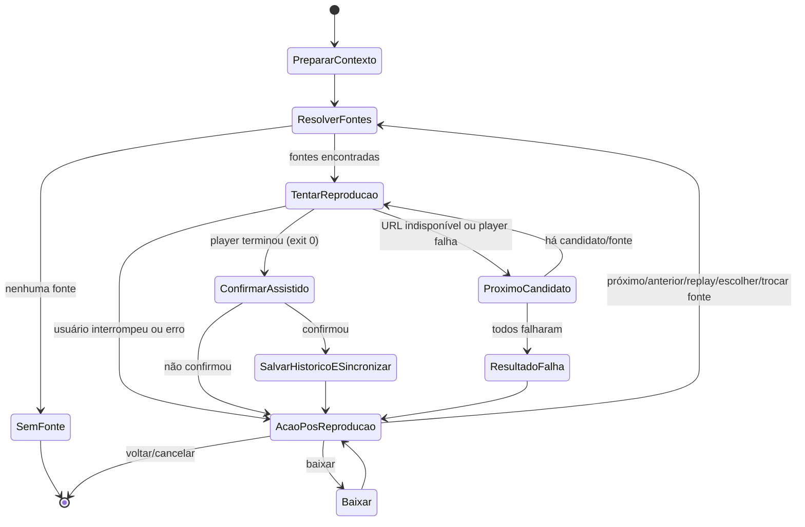
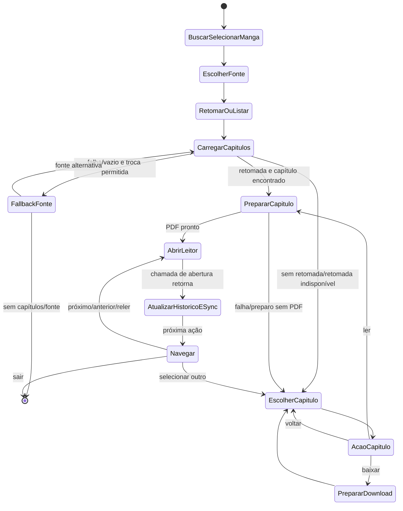
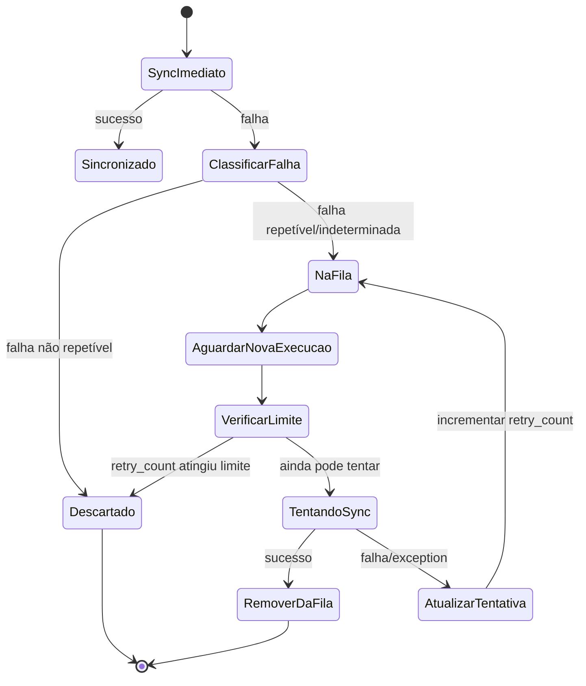
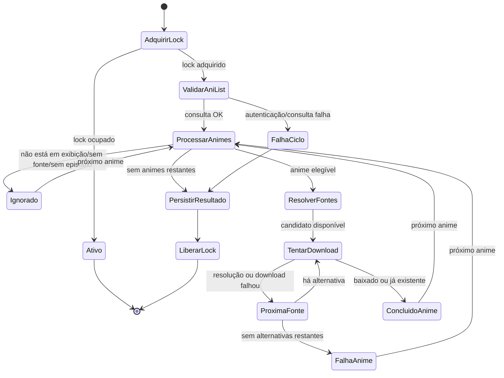

# Fluxos com estado implícito

Este documento registra os principais fluxos cuja próxima ação depende de
loops, escolhas de menu, resultados de serviços ou estado persistido. Não
propõe uma refatoração por si só: serve como mapa para revisar transições e
definir invariantes antes de alterar o código.

## 1. Reprodução de anime

**Estado carregado pelo fluxo:** `PlaybackContext` (anime, episódio, fontes e
metadados AniList), `current_player_url` e resultado do player.

**Transições no código:** [commands/anime.py](commands/anime.py) coordena o
loop principal (397), classificação do resultado (515), confirmação somente
após saída normal (566) e ações de navegação (597). A tentativa de candidatos
fica em [services/anime/playback_service.py](services/anime/playback_service.py)
(389).

**Invariantes a preservar:** não gravar episódio como assistido em erro ou
interrupção; episódio no contexto permanece indexado a partir de zero; só
confirmar/sincronizar após saída normal; fallback não deve continuar após
interrupção explícita do usuário.

**Correção aplicada:** `PlaybackFallbackResult` agora devolve também a URL do
candidato que encerrou o fallback. A derivação de URL para o próximo episódio
usa essa URL, inclusive quando a fonte vencedora não é a primeira da lista.

## 2. Leitura de mangá

**Estado carregado pelo fluxo:** mangá selecionado, fonte, ponto de retomada,
lista de capítulos, índice atual e `auto_load_next`.

**Transições no código:** [services/manga/reading_flow.py](services/manga/reading_flow.py)
coordena busca e seleção (182), retomada, fonte e lista (261), download (434) e
leitura/navegação (652). A biblioteca local tem um loop semelhante em
[manga_tupi.py](manga_tupi.py) (199).

**Invariantes a preservar:** o capítulo indicado pelo índice deve corresponder
à lista ordenada; mudança de fonte deve manter o capítulo alvo quando houver
retomada; limites primeiro/último capítulo não podem produzir índice inválido.

**Correção aplicada:** se não houver processo de leitor iniciado, o fluxo avisa
que o PDF continua salvo e não avança histórico nem sincronização. Quando o
leitor inicia, o fluxo pede confirmação explícita após o usuário fechá-lo e
aguarda o processo associado terminar. Só então atualiza o histórico, sincroniza
ou oferece navegação se o processo encerrar com sucesso. A confirmação também
cobre leitores que entregam o arquivo a uma instância já aberta e encerram o
processo de lançamento antes da janela do PDF.

## 3. Fila de sincronização AniList offline

**Estado persistido:** entradas com `retry_count`, `last_error`, dados do anime
e, para episódios locais, referência ao arquivo.

**Transições no código:** [services/anime/offline_sync_service.py](services/anime/offline_sync_service.py)
classifica falhas (`_classify_error`, 73), enfileira (132) e tenta novamente
(193). O modelo persistido está em [models/download.py](models/download.py)
(271).

**Invariantes a preservar:** atualizar a fila sem duplicar a mesma combinação
AniList/episódio; sucesso remove a entrada; falha incrementa a tentativa; uma
entrada local só pode apagar o arquivo após sincronização bem-sucedida e se a
configuração permitir.

**Correção aplicada:** falhas não repetíveis e entradas que atingem o limite
agora vão para `failed_entries` no mesmo arquivo JSON. O arquivo mantém as
entradas encerradas para consulta e as novas falhas repetíveis iniciam uma nova
tentativa, removendo um arquivo antigo da lista terminal. O log informa a
quantidade de falhas arquivadas.

## 4. Ciclo agendado de episódios em exibição

**Estado observado:** lock do processo e último resultado persistido; por anime,
status, motivo e contagens. O ciclo é limitado a uma execução.

**Transições no código:** [services/anime/airing_download_scheduler.py](services/anime/airing_download_scheduler.py)
adquire lock e inicia o ciclo (232), valida AniList e processa animes
(273 em diante), tenta fontes/downloads (função `_process_anime`, 393) e grava
o resultado (`_write_state`, 539). O resumo tem `completed`, `failed` ou
`active`.

**Invariantes a preservar:** execução concorrente não pode iniciar outro ciclo;
falha de um anime não deve impedir o processamento dos demais; o lock deve ser
liberado mesmo em erro; o resultado final deve refletir se qualquer anime
falhou.

**Correção aplicada:** se a gravação do estado falhar, `run_once` retorna um
`CycleResult` de falha com os resultados dos animes preservados e registra o
erro no log. O lock continua sendo liberado pelo `finally`. Ciclos ignorados
por já haver uma execução ativa continuam retornando `active` sem sobrescrever
o último resultado concluído.

## Ordem sugerida para mudanças

1. Revisar as transições e invariantes documentadas durante mudanças futuras.
2. Avaliar estados tipados para os fluxos onde os sentinelas atuais
   (strings, booleanos e códigos numéricos) dificultam manutenção.

Este mapa não inclui os loops menores de menus, edição de configuração,
seleção de busca, biblioteca local de anime/mangá ou os estados internos dos
plugins. Eles permanecem no inventário inicial, mas ficam fora desta primeira
passada de aprofundamento.
